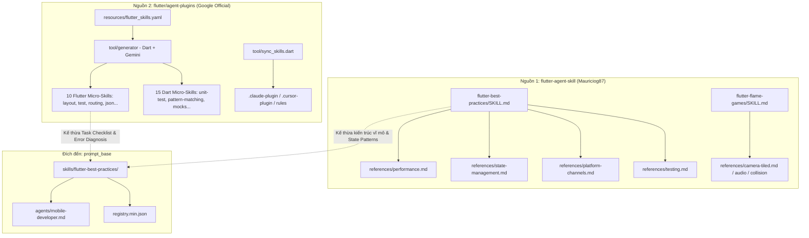

# Project Discovery Report — Flutter Agent Skills

> **Mục tiêu**: Phân tích, khám phá và bóc tách kiến trúc từ 2 repository tham khảo (`flutter-agent-skill` và `agent-plugins`) để làm tài nguyên kiến tạo bộ kỹ năng Flutter chuẩn mực (production-grade) cho dự án `prompt_base`.

---

## 1. High Level (TL;DR)

Hai repository được clone về đại diện cho hai triết lý thiết kế Agent Skill bổ trợ lẫn nhau hoàn hảo:

1. **[`references/flutter-agent-skill`](file:///home/ubuntu/my_projects/prompt_base/references/flutter-agent-skill)** (Mauriciog87): Tiếp cận theo mô hình **Macro-Skill (Kỹ năng diện rộng)**. Cung cấp bức tranh tổng thể về kiến trúc 3 lớp (Three-Layer), ma trận chọn State Management (Riverpod vs BLoC vs setState), điều hướng GoRouter, tối ưu frame rate & Isolates (`compute()`), Golden tests và cẩm nang phát triển game 2D với Flame Engine.
2. **[`references/agent-plugins`](file:///home/ubuntu/my_projects/prompt_base/references/agent-plugins)** (Google Flutter Team): Tiếp cận theo mô hình **Micro-Skill Ecosystem (Hệ sinh thái vi kỹ năng)** với 25 kỹ năng đơn nhiệm (10 Flutter + 15 Dart). Điểm sáng kỹ thuật lớn nhất là hệ thống **Task Progress Feedback Loop**, bảng chẩn đoán chữ ký lỗi layout thời gian thực (`RenderFlex overflowed`, `Unbounded height/width`), và công cụ CLI tự động sinh skill (`tool/generator`) bằng Gemini API từ tài liệu chính thức `docs.flutter.dev`.

---

## 2. Technical Overview

| Tiêu chí | `flutter-agent-skill` | `agent-plugins` (Google Official) |
|---|---|---|
| **Tác giả** | Mauriciog87 (Cộng đồng chuyên gia) | Google / Flutter Official Team |
| **Phân loại** | Macro-skill bundle (Architecture & Game) | Micro-skills monorepo + Generator CLI |
| **Quy mô** | 2 skills lớn, 9 file references chuyên sâu | 25 skills (10 Flutter, 15 Dart), rules, CLI tool |
| **Độ phủ công nghệ** | Flutter 3.x, Riverpod 2, BLoC, Flame, GoRouter | Flutter SDK, Dart 3+, Mockito, Integration Test, MCP |
| **Key Directories** | - `flutter-best-practices/`: Kiến trúc app chính<br>- `flutter-flame-games/`: Làm game 2D | - `skills/`: 25 kỹ năng đơn nhiệm<br>- `resources/flutter_skills.yaml`: Source of truth<br>- `tool/generator/`: CLI sinh skill qua Gemini |

---

## 3. Architecture & Design Patterns



### Inferred ADRs (Quyết định Kiến trúc ngầm định)

| Quyết định | Bằng chứng mã nguồn | Lợi ích | Đánh đổi / Rủi ro | Độ tin cậy |
|---|---|---|---|---|
| **Micro-skills vs Macro-skill** | [agent-plugins/README.md:19-28](file:///home/ubuntu/my_projects/prompt_base/references/agent-plugins/README.md#L19-L28) vs [flutter-best-practices/SKILL.md:20-45](file:///home/ubuntu/my_projects/prompt_base/references/flutter-agent-skill/flutter-best-practices/SKILL.md#L20-L45) | Micro-skills tải ít token khi chỉ cần sửa lỗi cụ thể (như fix overflow); Macro-skill cho cái nhìn toàn cảnh khi bắt đầu dự án mới. | Micro-skills quá vụn làm loãng registry prompt_base. Cần gom theo cấu trúc file chính + `references/`. | **Cao** |
| **Single Source of Truth cho Skills** | [agent-plugins/resources/flutter_skills.yaml:8-56](file:///home/ubuntu/my_projects/prompt_base/references/agent-plugins/resources/flutter_skills.yaml#L8-L56) | Định nghĩa toàn bộ kỹ năng ở 1 file YAML, sau đó dùng CLI tự biên dịch ra các format của Claude/Cursor. | Phụ thuộc vào công cụ generator; cập nhật thủ công file đầu ra sẽ bị ghi đè khi re-run. | **Rất cao** |
| **Task Progress Feedback Loop** | [flutter-fix-layout-issues/SKILL.md:31-41](file:///home/ubuntu/my_projects/prompt_base/references/agent-plugins/skills/flutter-fix-layout-issues/SKILL.md#L31-L41) | Buộc agent phải tuân thủ checklist: *Capture lỗi -> Áp dụng fix -> Hot reload -> Verify -> Lặp lại*. | Tăng số lượt tool call nếu agent thực hiện quá máy móc. | **Cao** |
| **Separation of Concerns (Three-Layer)** | [flutter-best-practices/SKILL.md:22-44](file:///home/ubuntu/my_projects/prompt_base/references/flutter-agent-skill/flutter-best-practices/SKILL.md#L22-L44) | Tách biệt Presentation / Domain / Data rõ ràng, dễ test bằng Mockito và WidgetTester. | Tăng boilerplate code cho các app đơn giản hoặc POC. | **Cao** |

---

## 4. Bóc tách Chi tiết: `flutter-agent-skill` (Mauriciog87)

### Điểm sáng kỹ thuật (Engineering Highlights)

1. **Ma trận chọn State Management thực chiến** ([SKILL.md:188-197](file:///home/ubuntu/my_projects/prompt_base/references/flutter-agent-skill/flutter-best-practices/SKILL.md#L188-L197)):
   * **Ephemeral (Local) State**: Dùng `StatefulWidget` + `setState()`.
   * **Simple Shared State**: Dùng `StateProvider`.
   * **Async Data (API/Cache)**: Dùng `FutureProvider` hoặc `AsyncNotifierProvider`.
   * **Realtime Streams**: Dùng `StreamProvider`.
   * **Complex Logic / Event-driven**: Dùng `BLoC` hoặc `StateNotifier`.

2. **Quản lý Vòng đời & Phòng chống Rò rỉ Bộ nhớ (Memory Leaks)** ([SKILL.md:58-88](file:///home/ubuntu/my_projects/prompt_base/references/flutter-agent-skill/flutter-best-practices/SKILL.md#L58-L88)):
   * Bắt buộc kiểm tra `if (mounted)` trước mọi `setState()` bất đồng bộ.
   * Quy tắc vàng: Bắt buộc gọi `dispose()` trên mọi `TextEditingController`, `ScrollController`, `AnimationController`, `StreamSubscription`.
   * Giới hạn `PaintingBinding.instance.imageCache` để tránh sập app do tràn RAM trên thiết bị cấp thấp.

3. **Offload tác vụ nặng qua Dart Isolates (`compute()`)** ([SKILL.md:430-444](file:///home/ubuntu/my_projects/prompt_base/references/flutter-agent-skill/flutter-best-practices/SKILL.md#L430-L444)):
   * Hướng dẫn chi tiết cách đẩy việc parse JSON payload lớn hoặc mã hóa/giải mã ra khỏi Main UI Thread thông qua `compute()`, đảm bảo duy trì ổn định 60fps/120fps.

4. **Kỹ thuật phát triển Game 2D với Flame** ([flutter-flame-games/SKILL.md:1-60](file:///home/ubuntu/my_projects/prompt_base/references/flutter-agent-skill/flutter-flame-games/SKILL.md#L1-L60)):
   * Bao quát từ Game Loop (`update(dt)`, `render(canvas)`), Component hierarchy, Hitbox collision detection, Joystick/Keyboard input, Camera scrolling và Tiled maps integration.

---

## 5. Bóc tách Chi tiết: `agent-plugins` (Google Flutter Team)

### Điểm sáng kỹ thuật (Engineering Highlights)

1. **Bảng chẩn đoán chữ ký lỗi Layout (Constraint Violation Signatures)** ([flutter-fix-layout-issues/SKILL.md:19-26](file:///home/ubuntu/my_projects/prompt_base/references/agent-plugins/skills/flutter-fix-layout-issues/SKILL.md#L19-L26)):
   * `"Vertical viewport was given unbounded height"`: Xảy ra khi đặt widget cuộn (`ListView`, `GridView`) vào trong cha không ràng buộc chiều dọc (`Column`) -> **Giải pháp**: Bọc bằng `Expanded` hoặc `SizedBox(height: ...)`.
   * `"An InputDecorator...cannot have an unbounded width"`: `TextField` đặt trong `Row` -> **Giải pháp**: Bọc bằng `Expanded` hoặc `Flexible`.
   * `"RenderFlex overflowed"`: Phần tử con đòi kích thước vượt quá cha -> **Giải pháp**: Bọc bằng `Expanded`, `Flexible`, hoặc `SingleChildScrollView`.
   * `"RenderBox was not laid out"`: Là lỗi phụ thứ cấp phát sinh (cascading side-effect) -> **Quy tắc**: Bỏ qua dòng này, kéo lên đầu stack trace để tìm lỗi vi phạm ràng buộc ban đầu.

2. **Architecture Guideline chính thức từ Google** ([flutter-apply-architecture-best-practices/SKILL.md:20-53](file:///home/ubuntu/my_projects/prompt_base/references/agent-plugins/skills/flutter-apply-architecture-best-practices/SKILL.md#L20-L53)):
   * Khuyến nghị mô hình **MVVM**:
     * **Views**: Pure UI widgets, không chứa business logic, chỉ lắng nghe thông qua `ListenableBuilder` hoặc `AnimatedBuilder`.
     * **ViewModels**: Kế thừa `ChangeNotifier`, nhận Dependencies qua Constructor, phơi bày immutable state.
     * **Data Layer**: Tách biệt rõ `Services` (gọi HTTP/DB thô) và `Repositories` (biến đổi dữ liệu thành Domain Models, quản lý cache & offline-first).

3. **CLI Tự động sinh Skill bằng GenAI** ([tool/generator/README.md:1-60](file:///home/ubuntu/my_projects/prompt_base/references/agent-plugins/tool/generator/README.md#L1-L60)):
   * Viết bằng Dart thuần, đọc file cấu hình [resources/flutter_skills.yaml](file:///home/ubuntu/my_projects/prompt_base/references/agent-plugins/resources/flutter_skills.yaml), gọi Gemini API (`gemini-3.1-pro-preview`) để tự động crawl tài liệu từ `docs.flutter.dev` và biên soạn ra các file `SKILL.md` đạt chuẩn định dạng Anthropic / Claude.

---

## 6. Top 10 Khái niệm Đáng học hỏi nhất cho Flutter

| # | Khái niệm | File tham khảo | Giá trị ứng dụng | Độ khó | Thứ tự đọc |
|---|---|---|---|---|---|
| 1 | **Constraint Diagnostics Matrix** | [agent-plugins/.../flutter-fix-layout-issues/SKILL.md](file:///home/ubuntu/my_projects/prompt_base/references/agent-plugins/skills/flutter-fix-layout-issues/SKILL.md#L19-L42) | Giúp AI sửa triệt để các lỗi overflow/unbounded thường gặp nhất ở Flutter | ⭐⭐ | L1 |
| 2 | **Three-Layer & MVVM Architecture** | [flutter-agent-skill/.../SKILL.md:20-45](file:///home/ubuntu/my_projects/prompt_base/references/flutter-agent-skill/flutter-best-practices/SKILL.md#L20-L45) | Quy chuẩn phân lớp thư mục và dependency rule cho mọi dự án Flutter lớn | ⭐⭐⭐ | L2 |
| 3 | **State Decision Tree (Riverpod vs BLoC)** | [flutter-agent-skill/.../state-management.md](file:///home/ubuntu/my_projects/prompt_base/references/flutter-agent-skill/flutter-best-practices/references/state-management.md#L1-L60) | Biết chính xác khi nào dùng Riverpod, BLoC hay `setState` | ⭐⭐⭐ | L2 |
| 4 | **Testing Pyramid (Unit -> Widget -> Integration)** | [flutter-agent-skill/.../testing.md](file:///home/ubuntu/my_projects/prompt_base/references/flutter-agent-skill/flutter-best-practices/references/testing.md) | Mẫu test chuẩn với `WidgetTester`, Mockito và Golden test chống vỡ UI | ⭐⭐⭐ | L3 |
| 5 | **Declarative Routing & Deep Linking** | [agent-plugins/.../flutter-setup-declarative-routing](file:///home/ubuntu/my_projects/prompt_base/references/agent-plugins/skills/flutter-setup-declarative-routing/SKILL.md) | Thiết lập `go_router` với auth redirect và URL deep links | ⭐⭐ | L3 |
| 6 | **Performance & Frame Budget (60fps/120fps)** | [flutter-agent-skill/.../performance.md](file:///home/ubuntu/my_projects/prompt_base/references/flutter-agent-skill/flutter-best-practices/references/performance.md) | Kỹ thuật `const`, `RepaintBoundary`, `ListView.builder`, DevTools profiling | ⭐⭐⭐⭐ | L4 |
| 7 | **Memory Safety & Disposal Lifecycle** | [flutter-best-practices/SKILL.md:58-88](file:///home/ubuntu/my_projects/prompt_base/references/flutter-agent-skill/flutter-best-practices/SKILL.md#L58-L88) | Ngăn ngừa triệt để hiện tượng rò rỉ bộ nhớ (leak stream/controller) | ⭐⭐⭐ | L4 |
| 8 | **Skill Generator Tooling** | [agent-plugins/tool/generator/](file:///home/ubuntu/my_projects/prompt_base/references/agent-plugins/tool/generator/README.md) | Công thức tự động hóa việc crawl doc -> prompt LLM -> render skill markdown | ⭐⭐⭐⭐ | L5 |
| 9 | **Dart 3 Modern Language Features** | [agent-plugins/skills/dart-use-pattern-matching](file:///home/ubuntu/my_projects/prompt_base/references/agent-plugins/skills/dart-use-pattern-matching/SKILL.md) | Áp dụng Records, Pattern Matching, Sealed classes vào Domain logic | ⭐⭐⭐ | L3 |
| 10 | **2D Game Loop với Flame** | [flutter-agent-skill/flutter-flame-games](file:///home/ubuntu/my_projects/prompt_base/references/flutter-agent-skill/flutter-flame-games/SKILL.md) | Kiến trúc game nhẹ, Sprite animation và collision detection trong Flutter | ⭐⭐⭐⭐ | L5 |

---

## 7. Anti-Patterns & Những điều KHÔNG NÊN làm theo

1. **Không tạo 25 micro-skills rời rạc vào registry của `prompt_base`**:
   Mô hình 25 micro-skills của Google thích hợp cho plugin hẹp. Đối với `prompt_base`, nạp hàng chục file skill nhỏ sẽ gây token bloat và nhiễu ngữ cảnh. Nên gộp thành 1 Macro-Skill chủ đạo (`flutter-best-practices`) kèm các sub-modules tại `references/` để load JIT (Just-In-Time).
2. **Không dùng `SingleChildScrollView` bừa bãi để dập lỗi overflow**:
   Nhiều prompt/agent cố sửa lỗi `RenderFlex overflowed` bằng cách bọc vô tội vạ `SingleChildScrollView`, dẫn đến việc huỷ bỏ cơ chế lazy loading của các danh sách con và gây lag UI. Cần sửa đúng căn nguyên (dùng `Expanded`/`Flexible` đúng trục flex).
3. **Không đặt side-effects hoặc tính toán nặng trong `build()`**:
   Hàm `Widget build(BuildContext context)` có thể bị gọi hàng chục lần mỗi giây. Tuyệt đối không khởi tạo controller, không fetch HTTP, không parse JSON phức tạp tại đây.

---

## 8. Đánh giá Tổng thể (Overall Evaluation)

| Tiêu chí | `flutter-agent-skill` | `agent-plugins` | Đánh giá tổng hợp |
|---|---|---|---|
| **Architecture (Kiến trúc)** | 9/10 | 9.5/10 | Chuẩn Clean Architecture & MVVM thực chiến |
| **Maintainability (Bảo trì)** | 8.5/10 | 9.5/10 | File YAML tập trung và generator của Google rất dễ duy trì |
| **Completeness (Độ bao phủ)** | 9.5/10 | 8.5/10 | `flutter-agent-skill` bao quát cả Flame Games, Firebase, CI/CD |
| **Agent Actionability (Khả thi cho AI)** | 8.5/10 | 9.5/10 | Checklists và Error Signatures của Google giúp AI ít ảo giác hơn |
| **Learning Value cho prompt_base** | **9.5/10** | **9.5/10** | Cặp bài trùng lý tưởng để xây dựng bộ kỹ năng Flutter hoàn chỉnh |

---

## 9. Kế hoạch Hành động (Action Plan cho Flutter trong `prompt_base`)

### Bước 1: Xây dựng skill `skills/flutter-best-practices`
* **Cấu trúc**:
  ```text
  skills/flutter-best-practices/
  ├── SKILL.md                          # Kiến trúc MVVM, State Decision Tree, Lifecycle
  └── references/
      ├── layout-and-constraints.md     # Bảng chẩn đoán lỗi layout (Google) & Responsive
      ├── state-management.md           # Riverpod 2 & BLoC patterns
      ├── testing.md                    # Unit, WidgetTester, Golden, Integration Test
      └── performance-optimization.md   # Memory leaks, Isolates, Const rules
  ```

### Bước 2: Cập nhật Agent `agents/mobile-developer.md`
* Bổ sung liên kết trực tiếp tới `skills/flutter-best-practices`, bổ sung từ khóa trigger (`flutter`, `riverpod`, `bloc`, `dart`, `widget`), và cập nhật checklist xác thực khi lập trình Flutter.

### Bước 3: Đồng bộ Registry của `prompt_base`
* Đăng ký skill mới vào [registry.min.json](file:///home/ubuntu/my_projects/prompt_base/registry.min.json) và chạy `make test`.
