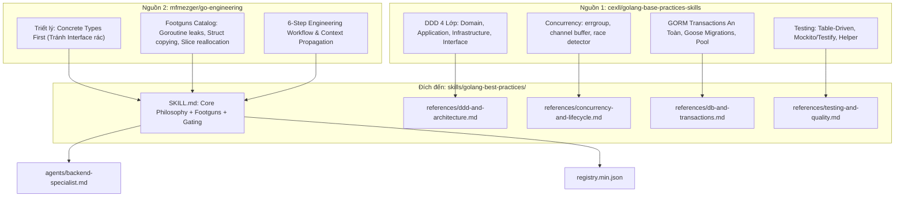

# Project Discovery Report — Golang Agent Skills

> **Mục tiêu**: Khám phá, bóc tách và đối chiếu 2 kho tài nguyên Go chuẩn mực (`golang-base-practices-skills` của cexll và `go-engineering` của mfmezger) nhằm chuẩn bị kế hoạch nâng cấp toàn diện skill `skills/golang-best-practices` trong `prompt_base`.

---

## 1. High Level (TL;DR)

Hai nguồn tài nguyên Go được nghiên cứu đại diện cho hai góc nhìn bổ trợ hoàn hảo:

1. **[`references/golang-base-practices-skills`](file:///home/ubuntu/my_projects/prompt_base/references/golang-base-practices-skills)** (cexll): Là một **hệ thống cẩm nang thực chiến chuyên sâu gồm 53 quy tắc nguyên tử** được phân bổ vào 9 nhóm ưu tiên. Nổi bật nhất là kiến trúc **DDD 4 lớp (Domain-Driven Design)**, chuẩn an toàn giao dịch cơ sở dữ liệu với GORM, mô hình điều khiển đồng thời bằng `errgroup`, và tiêu chuẩn kiểm thử Table-Driven hướng tới 99% coverage.
2. **`go-engineering` (mfmezger)**: Mang đậm **triết lý cốt lõi của Kiến trúc sư trưởng Go**: *"Concrete types first, small interfaces where callers benefit, no goroutines without explicit ownership"*. Kho tài nguyên này cung cấp một danh mục **Footguns (cạm bẫy chết người)** mà AI hay mắc phải: lạm dụng interface vô bổ, rò rỉ goroutine không có context hủy, và copy nhầm struct lớn.

---

## 2. Technical Overview So sánh Các Nguồn

| Tiêu chí | `golang-base-practices-skills` (cexll) | `go-engineering` (mfmezger) | `prompt_base` (Hiện tại) |
|---|---|---|---|
| **Tác giả** | cexll | mfmezger (ai_agent_dotfiles) | sunshine12396 |
| **Quy mô** | 53 rule files chi tiết trong `rules/*.md` | `SKILL.md` + 5 file `references/*.md` | `skills/golang-best-practices` (141 dòng, chưa có `references/`) |
| **Trọng tâm** | DDD, GORM, Goose, Gin/Kratos, Concurrency | Idiomatic Go, Footguns, Concrete Types, Workflow | Concurrency cơ bản, Generics, Project layout |
| **Framework & Tools** | Gin, Kratos, GORM, Goose, Testify, GolangCI-Lint | Go Standard Library, `errors.Is`/`errors.As`, `pprof` | Standard Library, GolangCI-Lint |
| **Mục đích thiết kế** | Xây dựng Microservices & REST/gRPC sản xuất | Định hướng tư duy kỹ thuật chuẩn cho Agent | Hướng dẫn tổng quan cho `backend-specialist` |

---

## 3. Kiến trúc Tổng thể & Luồng Chuyển giao vào `prompt_base`



### Inferred ADRs (Quyết định Kiến trúc ngầm định)

| Quyết định | Bằng chứng mã nguồn | Lợi ích | Đánh đổi / Rủi ro | Độ tin cậy |
|---|---|---|---|---|
| **Concrete Types First (Interface theo nhu cầu Caller)** | [go-engineering/SKILL.md:25](file:///home/ubuntu/.gemini/antigravity-ide/brain/e5d9a3d1-837f-4062-97e5-9cf140104f5c/.system_generated/steps/176/content.md#L25) | Giảm trừ tầng lớp trừu tượng thừa thãi, code dễ đọc và dễ nhảy code (navigation). | Phải refactor thêm interface khi thực sự cần mock hoặc đa hình. | **Rất cao** |
| **Kiến trúc DDD 4 Lớp Độc lập** | [rules/ddd-project-layout.md:15-55](file:///home/ubuntu/my_projects/prompt_base/references/golang-base-practices-skills/rules/ddd-project-layout.md#L15-L55) | Tách biệt hoàn toàn Core Domain khỏi Database và Framework HTTP. | Tăng số lượng boilerplate files đối với các CRUD siêu nhỏ. | **Rất cao** |
| **Giao dịch GORM dạng Closure** | [rules/db-gorm-transactions.md:26-55](file:///home/ubuntu/my_projects/prompt_base/references/golang-base-practices-skills/rules/db-gorm-transactions.md#L26-L55) | Đảm bảo 100% tự động rollback khi có lỗi hoặc panic, tránh rò rỉ uncommitted transaction. | Không áp dụng được nếu giao dịch kéo dài qua nhiều request (distributed transaction). | **Rất cao** |
| **Quản lý Concurrency bằng `errgroup.WithContext`** | [rules/concurrency-errgroup.md:20-45](file:///home/ubuntu/my_projects/prompt_base/references/golang-base-practices-skills/rules/concurrency-errgroup.md#L20-L45) | 1 tác vụ con fail sẽ lập tức cancel tất cả các goroutine còn lại, gom lỗi thanh lịch. | Cần capture biến loop rõ ràng `id := id` (Go < 1.22) và dùng Mutex bảo vệ kết quả gộp. | **Cao** |
| **Context là Tham số Đầu tiên, Không Lưu trong Struct** | [go-engineering/.../concurrency.md:18](file:///home/ubuntu/.gemini/antigravity-ide/brain/e5d9a3d1-837f-4062-97e5-9cf140104f5c/.system_generated/steps/191/content.md#L18) | Tránh stale context, vòng lặp tham chiếu và đảm bảo hủy request xuyên suốt call-stack. | Phải truyền `ctx` qua mọi hàm có I/O hoặc blocking. | **Rất cao** |

---

## 4. Bóc tách Chi tiết: `golang-base-practices-skills` (cexll)

Cexll phân bổ 53 quy tắc thành 9 nhóm chặt chẽ:

### 4.1. Kiến trúc DDD Chuẩn (Domain-Driven Design)
Quy tắc phụ thuộc một chiều bắt buộc:
* `interfaces` (HTTP Handlers, gRPC) → `application` (Use cases, Command/Query) → `domain` (Entities, Value Objects, Domain Services).
* `infrastructure` (MySQL, Redis, GORM, External APIs) → `domain` (thông qua Repository Interfaces).
* **Quy tắc vàng**: `domain` thuần túy, tuyệt đối không phụ thuộc vào `infrastructure`, GORM, hay bất kỳ package bên thứ ba nào.

### 4.2. Database & GORM Transaction Safety
* **Closure-based Transaction**:
  ```go
  func Transfer(db *gorm.DB, fromID, toID uint, amount int) error {
      return db.Transaction(func(tx *gorm.DB) error {
          // Thực hiện deduction & addition trên 'tx'
          if err := tx.Model(...).Error; err != nil {
              return err // Trả về error -> GORM tự động ROLLBACK
          }
          return nil     // Trả về nil -> GORM tự động COMMIT
      })
  }
  ```
* **Cấu hình Connection Pool**: Bắt buộc đặt `SetMaxOpenConns`, `SetMaxIdleConns`, `SetConnMaxLifetime` dựa trên tài nguyên database để tránh cạn kiệt socket.

### 4.3. Concurrency với `errgroup` & Lifecycle
* **Ngăn chặn rò rỉ Goroutine**: Không bao giờ gọi `go func()` mà không có điều kiện dừng rõ ràng hoặc gắn với `ctx.Done()`.
* **Kích thước Buffer của Channel**:
  * Unbuffered (`make(chan T)`): Cho việc đồng bộ hóa chặt (synchronization).
  * Buffered (`make(chan T, n)`): Chỉ khi biết chính xác giới hạn số lượng phần tử hoặc xử lý burst traffic, tránh đệm vô tội vạ gây tràn RAM.

### 4.4. Kiểm thử Chuyên nghiệp (Testing 99% Coverage Target)
* **Table-Driven Tests**: Tiêu chuẩn vàng cho mọi unit test (`[]struct{ name, input, expected, wantErr }`).
* **Test Fixtures & Mocks**: Tách biệt rõ unit test dùng mock interface và integration test dùng real testcontainers/database.

---

## 5. Bóc tách Chi tiết: `go-engineering` (mfmezger)

### 5.1. Triết lý "Concrete Types First"
Trong Go, lập trình viên từ Java/C# hay mắc bệnh "nghiện interface" — tạo interface cho mọi struct dù chỉ có 1 implementation duy nhất. 
* *Nguyên tắc Go chuẩn*: Bắt đầu bằng Struct cụ thể. Chỉ tạo Interface khi:
  1. Có từ 2 implementation trở lên trong runtime.
  2. Caller (bên tiêu thụ) thực sự cần trừu tượng hóa để mock khi viết unit test.
  3. Interface phải được định nghĩa ở **package của bên tiêu thụ (consumer)**, không phải ở package của bên cung cấp (producer).

### 5.2. Danh mục Cạm bẫy Chết người (Footguns Catalog)
1. **Goroutine không có Owner/Exit Condition**: Sinh ra goroutine chạy nền nhưng không có cơ chế dừng khi server shutdown hoặc request timeout -> Rò rỉ goroutine âm thầm làm cạn kiệt RAM.
2. **Context nhúng trong Struct**: Lưu `context.Context` vào trường của struct khiến context không được cập nhật theo từng request, gây bug cancel nhầm hoặc memory leak.
3. **Copy Struct lớn một cách vô tình**: Truyền struct chứa nhiều mảng/dữ liệu bằng value thay vì con trỏ (`*MyStruct`) trong các hàm chạy liên tục trên hot path.
4. **Append/Re-slice mà không hiểu Backing Array**: Dẫn đến việc ghi đè dữ liệu của slice khác đang cùng trỏ vào một mảng bộ nhớ bên dưới.
5. **So sánh lỗi bằng String Matching**: Thay vì dùng `errors.Is(err, ErrNotFound)` hoặc `errors.As(err, &targetErr)`, lại so sánh `err.Error() == "not found"`.

---

## 6. Top 10 Khái niệm Đáng học hỏi nhất cho Golang trong `prompt_base`

| # | Khái niệm | Nguồn | File tham khảo | Giá trị ứng dụng |
|---|---|---|---|---|
| 1 | **GORM Transaction Closure** | cexll | [rules/db-gorm-transactions.md](file:///home/ubuntu/my_projects/prompt_base/references/golang-base-practices-skills/rules/db-gorm-transactions.md) | Bảo toàn tính toàn vẹn dữ liệu tài chính, e-commerce |
| 2 | **"Concrete Types First" Doctrine** | mfmezger | [go-engineering/SKILL.md:25](file:///home/ubuntu/.gemini/antigravity-ide/brain/e5d9a3d1-837f-4062-97e5-9cf140104f5c/.system_generated/steps/176/content.md#L25) | Ngăn AI đẻ interface rác gây rối rắm codebase |
| 3 | **DDD 4-Layer Dependency Rule** | cexll | [rules/ddd-project-layout.md](file:///home/ubuntu/my_projects/prompt_base/references/golang-base-practices-skills/rules/ddd-project-layout.md) | Cấu trúc chuẩn mực cho microservice Go cấp doanh nghiệp |
| 4 | **Concurrency Control với `errgroup`** | cexll | [rules/concurrency-errgroup.md](file:///home/ubuntu/my_projects/prompt_base/references/golang-base-practices-skills/rules/concurrency-errgroup.md) | Gom lỗi và hủy bỏ song song khi 1 luồng gặp sự cố |
| 5 | **Explicit Context Propagation** | mfmezger | [references/concurrency.md](file:///home/ubuntu/.gemini/antigravity-ide/brain/e5d9a3d1-837f-4062-97e5-9cf140104f5c/.system_generated/steps/191/content.md#L18) | Truyền `ctx` ở tham số đầu tiên, xử lý hủy request chuẩn |
| 6 | **Footguns Catalog (Cạm bẫy Go)** | mfmezger | [references/performance-and-footguns.md](file:///home/ubuntu/.gemini/antigravity-ide/brain/e5d9a3d1-837f-4062-97e5-9cf140104f5c/.system_generated/steps/199/content.md) | Bộ lọc cảnh báo AI không phạm lỗi ngớ ngẩn |
| 7 | **Table-Driven Testing với Subtests** | cexll | [rules/testing-table-driven.md](file:///home/ubuntu/my_projects/prompt_base/references/golang-base-practices-skills/rules/testing-table-driven.md) | Viết test sạch, dễ mở rộng ca kiểm thử với `t.Run()` |
| 8 | **Error Wrapping (`%w`) & Sentinel Errors** | mfmezger / cexll | [rules/error-wrap-context.md](file:///home/ubuntu/my_projects/prompt_base/references/golang-base-practices-skills/rules/error-wrap-context.md) | Truy vết stacktrace sạch sẽ mà không mất gốc lỗi |
| 9 | **Database Connection Pool Optimization** | cexll | [rules/db-connection-pool.md](file:///home/ubuntu/my_projects/prompt_base/references/golang-base-practices-skills/rules/db-connection-pool.md) | Tránh làm nghẽn kết nối database trong môi trường production |
| 10 | **Preallocate Slices & Maps** | cexll / prompt_base | [rules/performance-prealloc.md](file:///home/ubuntu/my_projects/prompt_base/references/golang-base-practices-skills/rules/performance-prealloc.md) | `make([]T, 0, cap)` giảm thiểu cấp phát bộ nhớ & áp lực GC |

---

## 7. Anti-Patterns Cần Triệt Tiêu (Go Footguns)

1. **Không tạo Interface trước khi có Struct cụ thể**:
   Chỉ tạo interface ở bên tiêu thụ (`consumer`), không tạo interface bừa bãi ở bên cung cấp (`producer`).
2. **Không dùng `panic()` thay cho `error`**:
   `panic` chỉ dành cho lỗi không thể khắc phục khi khởi động ứng dụng (ví dụ thiếu file config bắt buộc, không kết nối được DB ban đầu). Trong business logic, 100% phải trả về `error`.
3. **Không bao giờ bỏ qua error return (`_ = doSomething()`)**:
   Mọi lỗi trả về phải được kiểm tra hoặc wrap ngữ cảnh `fmt.Errorf("...: %w", err)`.
4. **Không tạo goroutine "mồ côi" (Orphan Goroutines)**:
   Mọi goroutine đều phải gắn với `context.Context` hoặc channel đóng để đảm bảo shutdown an toàn.

---

## 8. Đánh giá Tổng thể (Overall Evaluation)

| Tiêu chí | `golang-base-practices-skills` | `go-engineering` | Đánh giá tổng hợp |
|---|---|---|---|
| **Architecture (Kiến trúc)** | **9.5/10** (DDD, Layout chuẩn) | **9.5/10** (Simplicity, Package boundary) | Rất cao, chuẩn mực enterprise |
| **Tính Thực chiến (Actionability)** | **10/10** (Ví dụ GORM, Gin, Table test) | **9.0/10** (Nguyên tắc súc tích) | Hoàn hảo cho việc code generation |
| **Phòng chống Lỗi (Safety)** | **9.0/10** (Race detection, Pool) | **10/10** (Footguns, Context rules) | Khắc phục triệt để các bug AI hay mắc |
| **Giá trị ứng dụng cho `prompt_base`** | **10/10** | **9.5/10** | **10/10** (Nguyên liệu hoàn hảo để nâng cấp) |

---

## 9. Kế hoạch Hành động Nâng cấp Go Skill trong `prompt_base`

Hiện tại, [skills/golang-best-practices](file:///home/ubuntu/my_projects/prompt_base/skills/golang-best-practices) chỉ có duy nhất 1 file `SKILL.md` (chưa có thư mục `references/`). Để đưa kỹ năng Go lên đẳng cấp cao nhất:

### Bước 1: Nâng cấp `skills/golang-best-practices/SKILL.md`
* Bổ sung khối **"NEVER Do in Go (Footguns Catalog)"** ngay đầu file từ triết lý của `go-engineering`.
* Bổ sung nguyên tắc **"Concrete Types First & Minimal Interface"**.
* Cập nhật quy tắc xử lý lỗi với `%w`, `errors.Is`, `errors.As`.

### Bước 2: Tạo mới thư mục `references/` với 4 module chuyên sâu
1. **`references/concurrency-and-lifecycle.md`**:
   * Mô hình `errgroup.WithContext`, Worker Pool, Graceful Shutdown.
   * Quản lý vòng đời Goroutine và luật truyền `context.Context`.
2. **`references/ddd-and-architecture.md`**:
   * Cấu trúc thư mục DDD chuẩn (`cmd/`, `internal/domain`, `internal/application`, `internal/infrastructure`, `internal/interfaces`).
   * Quy tắc phụ thuộc một chiều và Dependency Injection.
3. **`references/db-and-transactions.md`**:
   * Mẫu giao dịch GORM an toàn (Closure-based).
   * Goose migrations và cấu hình connection pool.
4. **`references/testing-and-quality.md`**:
   * Table-driven tests với subtests `t.Run`.
   * Mocking, Testify assert, Benchmark và Race detector `go test -race`.

### Bước 3: Cập nhật Agent `agents/backend-specialist.md`
* Bổ sung trigger và checklist kiểm thử cho Golang (Domain purity, Goroutine leak check, GORM transaction safety).
