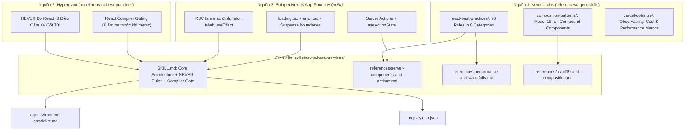

# Project Discovery Report — Next.js & React Agent Skills

> **Mục tiêu**: Báo cáo tổng hợp toàn diện bóc tách kho tài nguyên `references/agent-skills` (từ Vercel Labs) kết hợp với `accelint-react-best-practices` (Hypergiant) và các tiêu chuẩn Next.js App Router hiện đại, chuẩn bị cho việc nâng cấp skill `skills/nextjs-best-practices` trong `prompt_base`.

---

## 1. High Level (TL;DR)

Báo cáo này gom tụ **toàn bộ tri thức tinh hoa về Next.js và React hiện đại** từ 3 nguồn chất lượng cao:

1. **[`references/agent-skills`](file:///home/ubuntu/my_projects/prompt_base/references/agent-skills) (Vercel Labs)**: Hệ thống **70 quy tắc nguyên tử phân cấp thành 8 tầng ưu tiên**, dẫn đầu bởi **Eliminating Waterfalls** (`cheap-condition-before-await`, `defer-await`) và **Bundle Size Optimization** (nghiêm cấm barrel files, dynamic import). Đi kèm là chuẩn bảo mật Server Actions, API `after()` non-blocking, và Next.js 15 async cookies/headers.
2. **`accelint-react-best-practices` (Hypergiant / Accelint)**: Đóng góp bộ khung phòng vệ tối quan trọng: **"NEVER Do React"** (8 lỗi cấm kỵ phá hủy ứng dụng) cùng bộ câu hỏi chẩn đoán **React Compiler** trước khi tối ưu thủ công.
3. **Snippet Next.js Hiện Đại (App Router)**: Cố định tư duy App Router: Server Components mặc định, Server Functions kết hợp `useActionState`, bộ ba `loading.tsx` / `error.tsx` / `<Suspense>`, và Metadata API tĩnh.

---

## 2. Technical Overview

| Tiêu chí | `references/agent-skills` (Vercel Labs) | `accelint-react-best-practices` (Hypergiant) | `prompt_base` (Hiện tại) |
|---|---|---|---|
| **Tác giả** | Vercel Engineering / Labs | Accelint / Hypergiant | sunshine12396 |
| **Trọng tâm** | Performance, Server Actions, Bundle, Observability | Strict Anti-Patterns ("NEVER"), React Compiler, DX | Prompt & Agent Framework |
| **Quy mô** | 72 file `rules/*.md`, 108KB `AGENTS.md` | 1 file `SKILL.md` cô đọng + 8 cấm kỵ | [skills/nextjs-best-practices](file:///home/ubuntu/my_projects/prompt_base/skills/nextjs-best-practices/SKILL.md) (138 lines) |
| **Công nghệ đích** | Next.js 15+, React 19, Turbopack, SWR, Vercel CLI | React 19 (`Activity`, `useEffectEvent`, `ref` prop) | Next.js 15+, App Router |

---

## 3. Kiến trúc & Sơ đồ Luồng Nâng cấp cho `prompt_base`

---

## 4. Bóc tách Toàn diện Hệ thống 70 Quy tắc của Vercel Labs

Vercel Labs thiết lập thứ tự ưu tiên tối thượng: **Mạng & Bundle trước, Code Javascript sau**:

### Tầng 1: Triệt tiêu Waterfall (CRITICAL - Tác động lớn nhất)
* **`async-cheap-condition-before-await.md`**: Kiểm tra điều kiện đồng bộ rẻ trước khi `await` remote/database (ví dụ: check sự tồn tại của cookie hoặc cờ boolean local trước khi query cơ sở dữ liệu).
* **`async-defer-await.md`**: Đẩy lệnh `await` vào sâu trong nhánh thực tế sử dụng thay vì `await` ở đầu hàm gây nghẽn toàn bộ luồng.
* **`async-suspense-boundaries.md`**: Đặt `<Suspense>` bao quanh các khối giao diện async để stream nội dung động, giúp static shell hiển thị ngay lập tức (Partial Prerendering - PPR).

### Tầng 2: Tối ưu Bundle Size (CRITICAL)
* **`bundle-barrel-imports.md`**: **Nghiêm cấm import qua barrel files (`index.ts`)** đối với các thư viện lớn (như Lucide Icons, Lodash, Material UI). Phải import trực tiếp đường dẫn file (`lucide-react/dist/esm/icons/...`) để tránh nhồi hàng nghìn module thừa vào client bundle.
* **`bundle-dynamic-imports.md`**: Sử dụng `next/dynamic` cho các component nặng (Monaco Editor, Chart.js, PDF Viewer).

### Tầng 3: Tối ưu Phía Server (HIGH)
* **`server-auth-actions.md`**: Hàm `'use server'` là endpoint công khai như API route -> **Bắt buộc kiểm tra session và validate Zod bên trong action**, không ỷ lại vào middleware.
* **`server-after-nonblocking.md`**: Sử dụng API mới của Next.js 15: `after()` từ `next/server` để thực hiện tác vụ hậu kỳ (ghi log, bắn analytics, audit trail) mà không chặn response gửi về client.
* **`server-cache-react.md`**: Sử dụng `React.cache()` để deduplicate per-request các lệnh gọi database/API giữa Layout và Page.
* **`server-parallel-fetching.md`**: Fetch dữ liệu song song trong Server Components bằng composition hoặc `Promise.all()`, loại bỏ parent-child waterfall.
* **Next.js 15 Async Contract**: Bắt buộc `(await headers())` và `(await cookies())`.

### Tầng 4 & 5: Tối ưu Client & Tránh Re-render Thừa (MEDIUM)
* **`rerender-derived-state-no-effect.md`**: Tính toán derived state trực tiếp trong lúc render; **tuyệt đối không dùng `useState` + `useEffect` để đồng bộ state**.
* **`rerender-functional-setstate.md`**: Sử dụng updater function `setState(prev => ...)` để loại bỏ state khỏi dependency array của callbacks.
* **`rerender-no-inline-components.md`**: Không định nghĩa component lồng bên trong component.

---

## 5. Bóc tách Chi tiết: Accelint (`accelint-react-best-practices`)

### 8 Điều CẤM KỴ Tuyệt Đối ("NEVER Do React")

1. **NEVER define components inside components**: Khiến component con bị remount liên tục mỗi lần component cha render -> mất sạch local state, vỡ DOM, mất focus ở input và `useEffect` cleanup/setup bị gọi liên tục.
2. **NEVER subscribe to searchParams/localStorage trong body nếu chỉ dùng ở callback**: Khiến cả component bị re-render vô nghĩa mỗi khi URL thay đổi. Hãy đọc trực tiếp khi callback chạy: `new URLSearchParams(window.location.search)`.
3. **NEVER use object/array làm dependencies trong `useEffect`**: Object tạo mới reference mỗi render, gây kích hoạt effect liên tục hoặc lặp vô tận. Chỉ dùng primitive value (id, string, number).
4. **NEVER sync derived state bằng `useState` + `useEffect`**: Tạo re-render kép và state trung gian rác. Hãy tính toán thẳng: `const fullName = firstName + ' ' + lastName`.
5. **NEVER use client-only state trực tiếp trong SSR**: Đọc `localStorage`, `window` trực tiếp khi khởi tạo state gây ra lỗi kinh hoàng: Hydration Mismatch.
6. **NEVER use `forwardRef` trong React 19+**: API này đã lỗi thời (deprecated). React 19 cho phép truyền `ref` như một prop thông thường: `function Input({ ref, ...props })`.
7. **NEVER create inline callbacks/objects truyền vào memoized components**: Phá vỡ tính năng của `React.memo`.
8. **NEVER đưa tương tác người dùng vào `useEffect`**: Xử lý click/submit phải nằm trong event handler, không nằm trong effect.

### Bộ Lọc Chẩn Đoán React Compiler
Trước khi tối ưu thủ công (`useMemo`, `useCallback`, hoist JSX):
* Kiểm tra `package.json` xem có `babel-plugin-react-compiler` hoặc `react-compiler-webpack-plugin` không.
* Nếu **CÓ** -> Bỏ qua việc viết memo thủ công vì compiler tự xử lý.
* Nếu **KHÔNG** -> Áp dụng các quy tắc tối ưu của Vercel.

---

## 6. Bảng Inferred ADRs

| Quyết định | Bằng chứng mã nguồn | Lợi ích | Đánh đổi / Rủi ro | Độ tin cậy |
|---|---|---|---|---|
| **Xếp hạng Ưu tiên theo Tác động Thực** | [react-best-practices/SKILL.md:23-35](file:///home/ubuntu/my_projects/prompt_base/references/agent-skills/skills/react-best-practices/SKILL.md#L23-L35) | Buộc AI ưu tiên sửa Network Waterfall & Bundle Bloat trước khi tối ưu JS loops | Cần agent phân biệt ngữ cảnh mạng vs client | **Rất cao** |
| **Server Actions là Endpoint Công khai** | [server-auth-actions.md:10-15](file:///home/ubuntu/my_projects/prompt_base/references/agent-skills/skills/react-best-practices/rules/server-auth-actions.md#L10-L15) | Bắt buộc verify auth & validate Zod ngay trong Server Action, loại bỏ lỗ hổng bảo mật | Viết code lặp lại nếu không có wrapper HOC tiện ích | **Rất cao** |
| **Kiểm tra React Compiler trước khi Memoize** | [accelint-react-best-practices/SKILL.md:44-51](file:///home/ubuntu/.gemini/antigravity-ide/brain/e5d9a3d1-837f-4062-97e5-9cf140104f5c/.system_generated/steps/116/content.md#L44-L51) | Tránh viết thừa hàng trăm `useMemo`/`useCallback` khi project đã bật React Compiler | Cần đọc `package.json` trước khi đề xuất code | **Cao** |
| **Cấm Barrel Imports cho UI/Icons** | [bundle-barrel-imports.md:15](file:///home/ubuntu/my_projects/prompt_base/references/agent-skills/skills/react-best-practices/rules/bundle-barrel-imports.md#L15) | Giảm 40–70% kích thước gói JS client | Đường dẫn import dài hơn | **Cao** |
| **React 19 Ref as Prop** | [react19-no-forwardref.md:10](file:///home/ubuntu/my_projects/prompt_base/references/agent-skills/skills/composition-patterns/rules/react19-no-forwardref.md#L10) | Code sạch, loại bỏ boilerplate của `forwardRef` | Không tương thích ngược React 18 trở xuống | **Rất cao** |

---

## 7. Top 10 Khái niệm Đáng học hỏi nhất cho Next.js

| # | Khái niệm | Nguồn | File tham khảo | Giá trị ứng dụng |
|---|---|---|---|---|
| 1 | **Server Actions Auth & Validation** | Vercel | [server-auth-actions.md](file:///home/ubuntu/my_projects/prompt_base/references/agent-skills/skills/react-best-practices/rules/server-auth-actions.md) | Ngăn chặn lỗ hổng bảo mật nghiêm trọng trong App Router |
| 2 | **"NEVER Do React" (8 cấm kỵ)** | Accelint | [accelint/SKILL.md:22-41](file:///home/ubuntu/.gemini/antigravity-ide/brain/e5d9a3d1-837f-4062-97e5-9cf140104f5c/.system_generated/steps/116/content.md#L22-L41) | Đưa vào đầu prompt để AI không bao giờ phạm phải các bug ngớ ngẩn |
| 3 | **Non-blocking Response với `after()`** | Vercel | [server-after-nonblocking.md](file:///home/ubuntu/my_projects/prompt_base/references/agent-skills/skills/react-best-practices/rules/server-after-nonblocking.md) | Next.js 15+ API giúp tối ưu hóa TTFB tối đa cho route handlers |
| 4 | **Cheap Conditions Before Await** | Vercel | [async-cheap-condition-before-await.md](file:///home/ubuntu/my_projects/prompt_base/references/agent-skills/skills/react-best-practices/rules/async-cheap-condition-before-await.md) | Tránh gọi async/DB không cần thiết bằng việc check sync điều kiện |
| 5 | **Cấm Barrel File Imports** | Vercel | [bundle-barrel-imports.md](file:///home/ubuntu/my_projects/prompt_base/references/agent-skills/skills/react-best-practices/rules/bundle-barrel-imports.md) | Giảm 40-70% client bundle size khi dùng UI/icon libraries |
| 6 | **Deduplication với `React.cache()`** | Vercel | [server-cache-react.md](file:///home/ubuntu/my_projects/prompt_base/references/agent-skills/skills/react-best-practices/rules/server-cache-react.md) | Khử trùng lặp DB query giữa Layout và Page mà không cần truyền prop |
| 7 | **React Compiler Gating** | Accelint | [accelint/SKILL.md:42-60](file:///home/ubuntu/.gemini/antigravity-ide/brain/e5d9a3d1-837f-4062-97e5-9cf140104f5c/.system_generated/steps/116/content.md#L42-L60) | Kiểm tra cấu hình compiler trước khi viết `useMemo`/`useCallback` |
| 8 | **Parallel Data Fetching via Composition** | Vercel | [server-parallel-fetching.md](file:///home/ubuntu/my_projects/prompt_base/references/agent-skills/skills/react-best-practices/rules/server-parallel-fetching.md) | Tận dụng RSC để fetch song song thay vì tuần tự |
| 9 | **React 19 Ref as Prop & Actions** | Vercel | [composition-patterns/rules/react19-no-forwardref.md](file:///home/ubuntu/my_projects/prompt_base/references/agent-skills/skills/composition-patterns/rules/react19-no-forwardref.md) | Chuẩn hóa code theo phong cách React 19 hiện đại |
| 10 | **Async Headers & Cookies in Next.js 15** | Vercel | [server-after-nonblocking.md:45](file:///home/ubuntu/my_projects/prompt_base/references/agent-skills/skills/react-best-practices/rules/server-after-nonblocking.md#L45) | `(await headers())` và `(await cookies())` bắt buộc từ Next.js 15 |

---

## 8. Anti-Patterns & Những điều KHÔNG NÊN làm theo

1. **Không sao chép nguyên 72 file markdown vào `prompt_base`**:
   Làm như vậy sẽ gây token bloat khủng khiếp. Giải pháp đúng đắn là **tổng hợp tinh hoa thành 3 reference modules chuyên sâu** trong thư mục `skills/nextjs-best-practices/references/`.
2. **Không khuyến khích memoization tràn lan**:
   Với sự ra đời của React Compiler trong Next.js 15, việc viết hàng loạt `useCallback` và `useMemo` không còn là tiêu chuẩn mặc định nữa mà chỉ áp dụng khi thực sự đo đạc được bottleneck hoặc project chưa bật compiler.
3. **Không dùng `useEffect` để fetch dữ liệu**:
   Trong kiến trúc Next.js App Router, việc fetch ở client bằng `useEffect` là lỗi thời và sinh ra waterfall. Mọi thao tác đọc dữ liệu phải diễn ra ở Server Component hoặc dùng SWR/React Query có deduplication.

---

## 9. Đánh giá Tổng thể (Overall Evaluation)

| Tiêu chí | Điểm | Nhận xét |
|---|---|---|
| **Architecture (Kiến trúc)** | **9.8/10** | Chuẩn mực cấp cao nhất từ đội ngũ kỹ sư Vercel sáng lập Next.js |
| **Actionability (Khả thi cho AI)** | **10/10** | Các ví dụ Incorrect vs Correct rõ ràng, AI đọc hiểu ngay lập tức |
| **Tính Hiện đại (Modernity)** | **9.5/10** | Cập nhật Next.js 15+, React 19, async headers/cookies, `after()` API |
| **Giá trị ứng dụng cho `prompt_base`** | **10/10** | Hoàn hảo để đưa `nextjs-best-practices` của dự án lên chuẩn cao cấp |

---

## 10. Kế hoạch Hành động Nâng cấp Next.js Skill trong `prompt_base`

### Bước 1: Nâng cấp `SKILL.md` chính ([skills/nextjs-best-practices/SKILL.md](file:///home/ubuntu/my_projects/prompt_base/skills/nextjs-best-practices/SKILL.md))
* Bổ sung khối **"NEVER Do React & Next.js"** ngay đầu file (8 điều cấm kỵ từ Accelint).
* Bổ sung bộ lọc **"Before Optimizing Performance, Ask"** (Kiểm tra React Compiler).
* Cập nhật quy tắc routing và data fetching hiện đại từ snippet của User (`useActionState`, RSC mặc định, `loading.tsx` / `error.tsx` / `Suspense`).

### Bước 2: Tái cấu trúc thư mục `references/` thành 3 module chuyên sâu
1. **`references/server-components-and-actions.md`**:
   * Xác thực Server Actions bảo mật (`server-auth-actions`).
   * Sử dụng `after()` cho tác vụ ngầm (`server-after-nonblocking`).
   * Khử trùng lặp với `React.cache()` (`server-cache-react`).
   * Async Cookies & Headers trong Next.js 15.
2. **`references/performance-and-waterfalls.md`**:
   * Triệt tiêu Waterfall: `cheap-condition-before-await`, `defer-await`.
   * Tối ưu Bundle: Cấm import qua barrel file (`bundle-barrel-imports`), `next/dynamic`.
   * Dynamic vs Cached data fetching matrix trong Next.js 15.
3. **`references/react19-and-composition.md`**:
   * Chuẩn hóa React 19: `ref` as prop (không dùng `forwardRef`), `useActionState`.
   * Derived state không dùng `useEffect`.
   * Compound components và loại bỏ boolean props.

### Bước 3: Cập nhật Agent `agents/frontend-specialist.md`
* Bổ sung references và các checklist kiểm thử (pre-flight checks) cho React 19 & Next.js 15.
