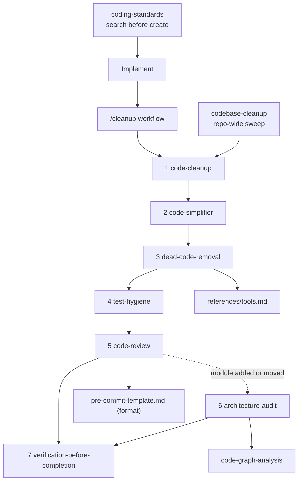

# Design: Cleanup skill family

## Key Decisions
- **Decision:** Order lives in a workflow; knowledge lives in skills.
  **Reason:** The workflow sequences steps and defines the report once; each skill stays usable alone when triggered by a prompt.
- **Decision:** Per-task cleanup is bounded by the change set; only a user-requested sweep goes wider.
  **Reason:** Removes the conflict between "leave it cleaner" and R8, keeps diffs reviewable, and makes "done" checkable.
- **Decision:** Two verdicts for removal: *proven unused* (delete) and *potentially unused* (report).
  **Reason:** A wrong deletion costs more than leftover code, and static tools miss dynamic use.
- **Decision:** `codebase-cleanup` is a router with the safety rules, not a seventh rule set.
  **Reason:** Old prompts keep working; no rule is defined twice.
- **Decision:** Existing review format stays where it is; `code-review` supplies the checklist.
  **Reason:** `verification-before-completion/references/pre-commit-template.md` already defines the OK / Not OK output; a second format would split reviews.
- **Decision:** Skills are tool-agnostic.
  **Reason:** The same skills deploy to Claude Code, Gemini, and Codex; only some have a built-in simplifier or a code-graph server.

## Approach
Two stages, because skill content depends on what the sources show.

1. **Discovery, read-only.** Clone four repos. Analyse each alone, then synthesise. Stop for user review.
2. **Authoring.** Scaffold, write, wire, gate, deploy.

### Discovery template (one section per source)
| Field | Content |
|---|---|
| Identity | Repo, licence, commit read, size |
| Files read | Exact paths (index repos: which entries and why) |
| What it does | Mechanism: prompt, checklist, agent, hook, or script |
| Strong ideas | With file and line evidence |
| Weak or risky ideas | For example auto-fix without review, style opinions presented as rules |
| Adopt / adapt / reject | One line each, with reason |
| Safety notes | Anything matching the R1 red flags |

Synthesis: one table, idea → target skill → conflicts with an existing rule in this repo → decision. Plus a list of user-table items no source supports, kept or dropped with a reason.

For the two index repos, select entries by searching names and descriptions for: cleanup, clean, slop, simplif, dead code, unused, refactor, review, test quality, flaky, mock, architecture, audit. Cap at about ten entries each and record what was skipped.

## Alternatives Considered
- **One expanded `codebase-cleanup`:** rejected by the user; one large skill loads every concern for any trigger.
- **Rule R12 in the three rule files:** strongest enforcement, but edits agent controls and needs three symmetric files. Deferred.
- **Wire Ruff and Vulture into `make verify`:** new dependencies for a small Python surface.
- **Drop `code-review` and extend `verification-before-completion`:** less surface, but the user asked for six skills, and the diff checklist is cleanup-specific while verification is about evidence for claims.
- **Rename `codebase-cleanup` to `cleanup-sweep`:** clearer, but breaks an existing name for little gain.

## Architecture


## Interfaces & Contracts

### Skill skeleton
Every skill in the family uses the same five headings so agents can scan them: **When to use / When not to use**, **Scope**, **Checklist**, **Stop and ask**, **Report**. "When not to use" names the sibling skill that owns the neighbouring case.

### Trigger keyword plan
The trigger test matches whole keywords in the prompt and fails a skill under 0.9 precision or recall. Starting plan, to be adjusted after discovery and the collision report:

| Skill | Keywords |
|---|---|
| `codebase-cleanup` | codebase cleanup, repo cleanup, clean up the codebase, tech debt sweep |
| `code-cleanup` | ai slop, deslop, clean up my changes, post-task cleanup, leftover code |
| `code-simplifier` | simplify code, over-engineering, over-engineered, unnecessary abstraction, reduce complexity |
| `dead-code-removal` | dead code, unused code, unused imports, unused dependencies, obsolete code |
| `code-review` | review diff, review my changes, self-review, final diff |
| `architecture-audit` | architecture audit, circular dependency, module boundaries, layering violation |
| `test-hygiene` | test hygiene, flaky test, over-mocking, redundant tests, test quality |

Known interaction: `architecture` triggers on the word "architecture", so cases containing "architecture audit" expect both skills.

### Report (defined in `/cleanup`, reused by the sweep)
```
Removed:            <item> — <evidence in one line>
Simplified:         <item> — <what and why>
Potentially unused: <item> — <what could not be verified>
Left on purpose:    <item> — <reason>
Noticed, not changed: <item outside the change set>
Verification:       <command> → <result>
```

### Evidence record (`dead-code-removal`)
Item, kind (symbol, file, dependency, test), searches run, dynamic-use checks done, tool output, verdict.

### Tool table shape (`references/tools.md`)
Ecosystem, tool, what it finds, report-only command, known false positives, how to detect that the project already uses it.

## Security Boundaries
- Clones are untrusted data. Read only: no install, build, test, hook, or script from a clone. `git clone` itself runs no repo code; the script does not use submodules.
- These repos consist of prompts by nature. Reading and paraphrasing them is the task; the R1 stop applies when content targets the reader (hidden or encoded text, run or fetch requests, data sending, configuration changes).
- Tool commands in skills are report-only. Auto-fix flags are allowed only for the change set and only when followed by `code-review`.
- `make install` removes and rebuilds skill directories under the home directory; the user runs it, the agent does not.

## Performance Considerations
N/A at runtime. Context cost is the budget: bodies at or under 150 lines, references loaded on demand, and the workflow names skills without copying their content.

## Observability
- `make skill-check`: lint warnings, keyword collision report, per-skill precision and recall.
- After release, wrong deletions or noisy cleanup are logged in `docs/reports/skill-feedback.md` (Tier 4 journal).

## Risks
| Risk | Mitigation |
|---|---|
| Keyword overlap inside the family or with existing skills | Keyword plan, collision report must be empty for the family, near-miss cases |
| `code-cleanup` and `codebase-cleanup` confused | First sentence of each description states per-task versus repo-wide; "When not to use" cross-links |
| Rule duplicated across skills | One-owner table; Phase 2 grep check |
| Over-aggressive deletion | Evidence record, two verdicts, manual evidence beats tools |
| Cleanup inflates diffs | Change-set scope, "Noticed, not changed" |
| `coding-standards` passes 150 lines | Write-time section is at most eight lines; overflow goes to its existing `references/extended-reference.md` |
| Index repos flood discovery | Keyword filter, ten-entry cap, skipped list |
| Injection from cloned content | Data-only handling, paraphrase, stop on red flags |
| Stale counts and names in `ARCHITECTURE.md` keep drifting | Fix the three stale names and the counts in this task; counts come from `registry.min.json` and a directory listing, not memory |
