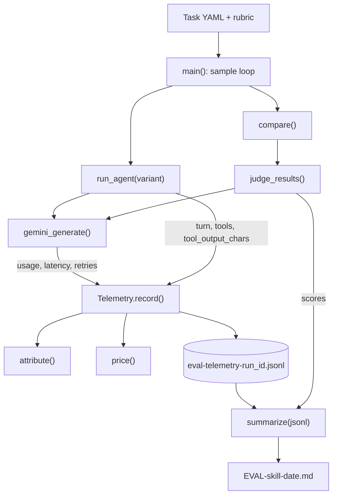

# Design: Token Telemetry & Evaluator Enhancement

## 1. Key Decisions
| Decision | Reason |
|---|---|
| Append-only JSONL, one file per run, flushed per record | A run aborted on quota keeps every earlier call; JSONL needs no dependency and loads into pandas or DuckDB later |
| Attribution by differences of provider counts | Exact for fixed prompt and skill body; no tokenizer, no extra calls; error confined to one derived split (model reply vs tool output) |
| Absolute score returned by the existing judge call | ΔQ needs absolute quality; a second call per output would double judge cost |
| Unknown price is `null`, never a default | A default rate produces believable wrong numbers |
| Report computed from JSONL | Report and trace cannot disagree (invariant 2) |
| Agent loop untouched | The evaluator must measure the cost of real use; re-sending instructions and history every turn is how stateless chat APIs work |

## 2. Attribution model
For one sample S and variant V, let `P_k` be `promptTokenCount` at turn k and `O_k` be `candidatesTokenCount`.

```
fixed          = P_1(baseline, S)                    # instruction + user prompt + tool declarations
skill          = P_1(V, S) - fixed                   # 0 for baseline; unknown without a baseline run
growth_k       = P_k - P_(k-1)                       # tokens appended between turns
reply_k        = min(growth_k, O_(k-1))              # the model message re-sent as input
tool_k         = growth_k - reply_k                  # function responses re-sent as input
model_replies  = Σ reply_j   (j = 2..k)
tool_outputs   = Σ tool_j    (j = 2..k)
P_k            = fixed + skill + model_replies + tool_outputs   # exact by construction
```

Why this is sound: `contents` is append-only in `run_agent()`; between turns k−1 and k exactly two messages are appended (the model message from turn k−1 and the function responses). Thinking tokens are not re-sent, so `O_(k-1)` excludes `thoughtsTokenCount`. The one approximation is that a re-sent model message costs `O_(k-1)` tokens as input; any difference lands in `tool_outputs`.

Because baseline and new run in the same sample loop, `fixed` for S is known before new's turn 1, and the computation is one pass with no lookahead.

**Cumulative input** over a sample is `Σ_k P_k`. Each `tool_outputs` token at turn k is paid again on every later turn; the report shows this as "re-sent tool output", the figure most useful for deciding whether a skill should tell the agent to read less.

## 3. Architecture



## 4. Interfaces

### 4.1 `gemini_generate()` return
Unchanged JSON body, plus a private key `_meta = {"latency_ms", "retries", "model"}` the caller strips before use. Latency starts after the rate-limit sleep and covers only the final successful `urlopen`.

### 4.2 Telemetry
```python
class Telemetry:
    def __init__(self, path: Path, context: dict): ...        # opens file, raises OSError early
    def record(self, *, variant, task_id, run_no, turn_no, model,
               response, skill_sha256=None, tools_called=(), tool_output_chars=0,
               breakdown=None, error=None) -> dict: ...         # writes + flushes, returns record
    def close(self): ...
```
One instance per process, passed explicitly to `run_agent()` and `compare()`; no module global beyond the existing `llm_call_count`.

### 4.3 Pure functions (unit-tested offline)
```python
def usage_of(response) -> dict                                   # tokens + usage_missing
def attribute(prompt_tokens: list[int], outputs: list[int], fixed: int | None) -> list[dict]
def load_pricing(path: Path) -> dict                             # {} on missing or invalid file
def price(tokens: dict, model: str, pricing: dict) -> float | None
def quality_from_verdict(verdict, swapped: bool, ref_variant, cand_variant) -> dict
def summarize(records: list[dict], quality: list[dict], pass_score: dict) -> dict
def recommend(summary: dict) -> str
```

### 4.4 Judge template change
Appended to `evals/golden/judge_template.txt`:
```
Also score each version on its own, as the rubric-weighted mean of 0-10 item scores times 10:
"scores": {"first": <0-100 for Old Version>, "second": <0-100 for New Version>}
```
The headings "Old Version" / "New Version" stay, so verdicts remain comparable in meaning. `evaluator_version` becomes 2.

### 4.5 `evals/pricing.json`
```json
{
  "version": "YYYY-MM-DD",
  "source": "<official pricing page URL, filled by the user>",
  "currency": "USD",
  "models": {
    "<model id>": {
      "input_per_million": null,
      "cached_input_per_million": null,
      "output_per_million": null
    }
  }
}
```
Shipped with the model ids used in this repository and `null` prices. A model whose prices are null counts as unpriced. Long-context price tiers are out of scope; if the provider charges more above a context threshold, the report notes that cost is a lower bound.

### 4.6 `read_file` parameters
`start_line`, `end_line`: optional integers, 1-indexed, inclusive. Declared in `FUNCTION_DECLARATIONS` so every variant gets the same tool schema (the declaration change itself raises every variant's `fixed` tokens equally).

### 4.7 Report additions
1. **Run context**: run id, git sha, baseline ref, evaluator version, pricing version, link to the JSONL file.
2. **Token breakdown** per variant: fixed / skill / model replies / tool outputs, as mean per sample and share of cumulative input; "re-sent tool output" total.
3. **Cost**: agent cost per variant, judge cost, total; UNPRICED where applicable.
4. **Efficiency**: Q, ΔQ, T, ΔT, efficiency, success rate, cost per success.
5. **Recommendation** with the decision-table row that matched.

## 5. Alternatives considered
| Alternative | Why not now |
|---|---|
| Character-ratio estimation, normalized to the total | Error is unknown and shifts between segments; normalization hides it |
| Gemini `countTokens` per segment | Exact, but 4+ extra calls per turn under a 15 RPM limit; candidate for an opt-in `--exact-attribution` later |
| SQLite | No query need yet; JSONL is append-safe and greppable |
| LangSmith / Phoenix | External service, sends prompts out of the machine (R4) |
| Separate scoring call per output | Doubles judge cost |
| 500-line cap on `read_file` | Changes agent behavior for every variant; breaks comparison with earlier reports |

## 6. Security boundaries
- Records hold counts, names, hashes, and short error text only (see specs.md "Never in a record").
- Error text is cut to 300 characters; the API key travels in a header and never appears in it. Tests assert that a record serialized from a response carrying a fake key in the error does not contain it.
- `read_file` keeps `_safe_path()`; line ranges are parsed as integers and rejected otherwise.
- JSONL lives in gitignored `docs/reports/`.

## 7. Performance
Attribution and pricing are integer arithmetic over at most `MAX_TOOL_TURNS` values. One `write` + `flush` per API call; each call already sleeps 5 seconds, so file I/O is negligible.

## 8. Risks
| Risk | Mitigation |
|---|---|
| Absolute scores from a pairwise prompt are anchored to the other answer | Each `new` output is scored in two different pairings and averaged; documented as a limitation |
| Score drift after a model change | `evaluator_version`, `model`, `git_sha` in every record; compare only like with like |
| Small samples drive the recommendation | Row 1 of the decision table (INSUFFICIENT_DATA) |
| Provider changes usage field names | `usage_missing` flag; no crash |
